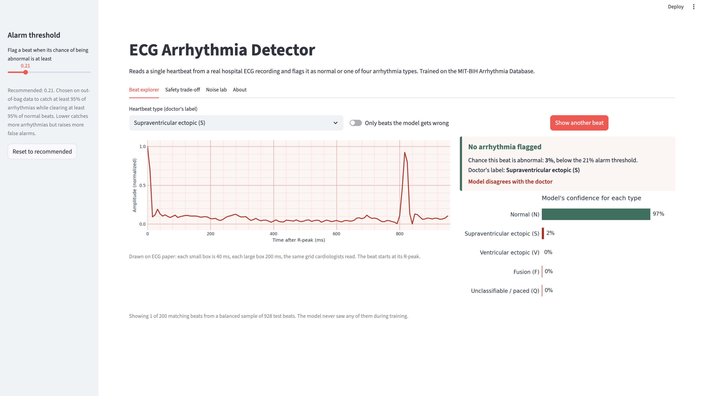
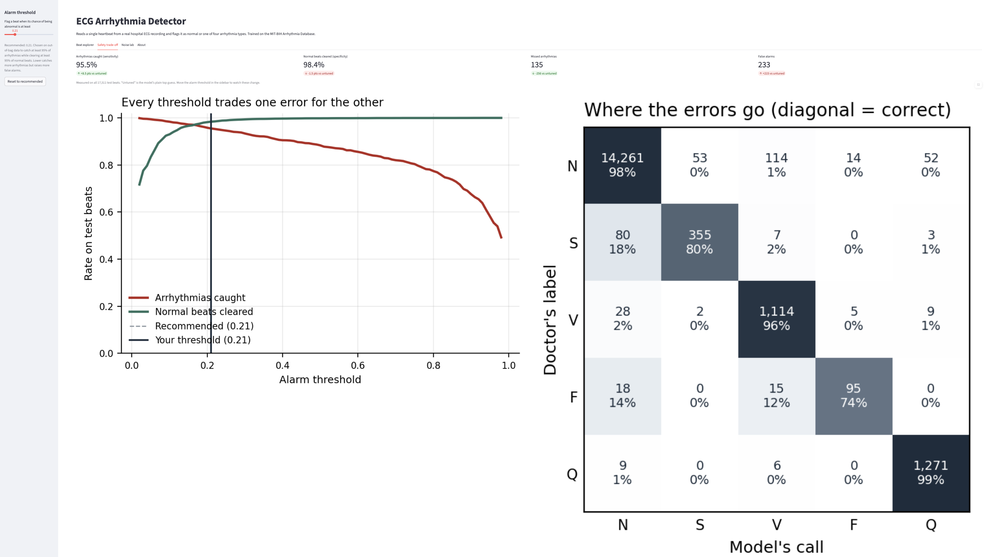
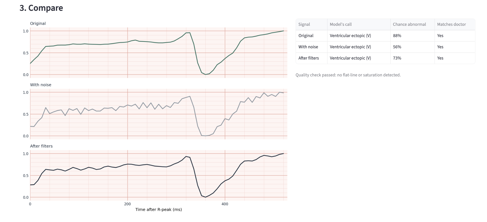
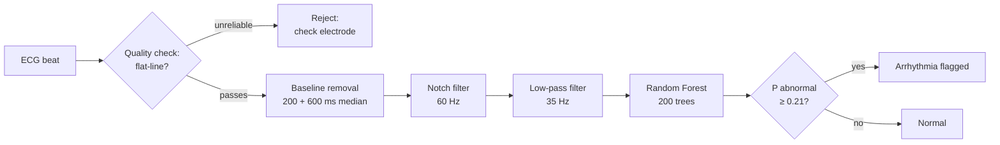
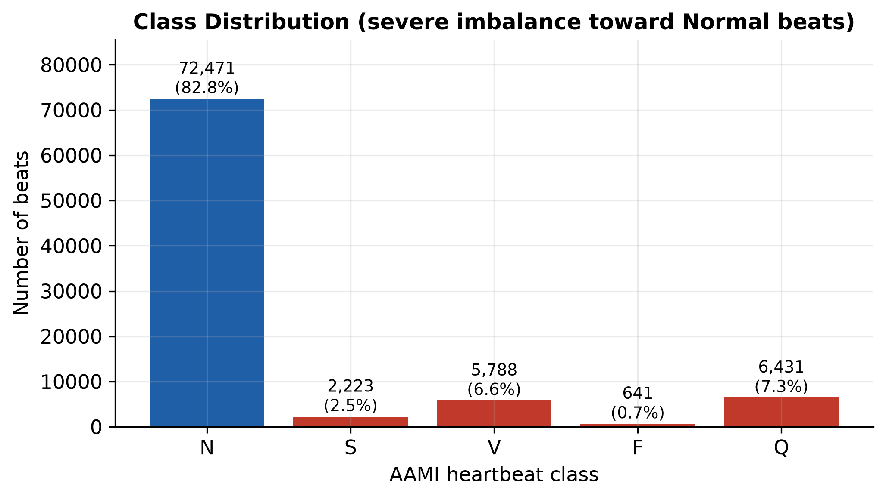
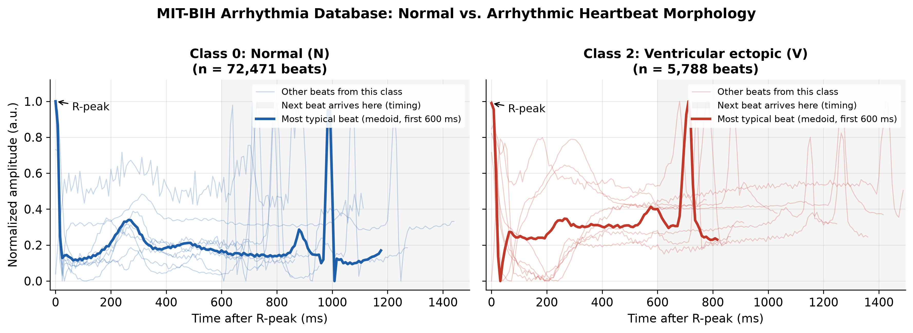
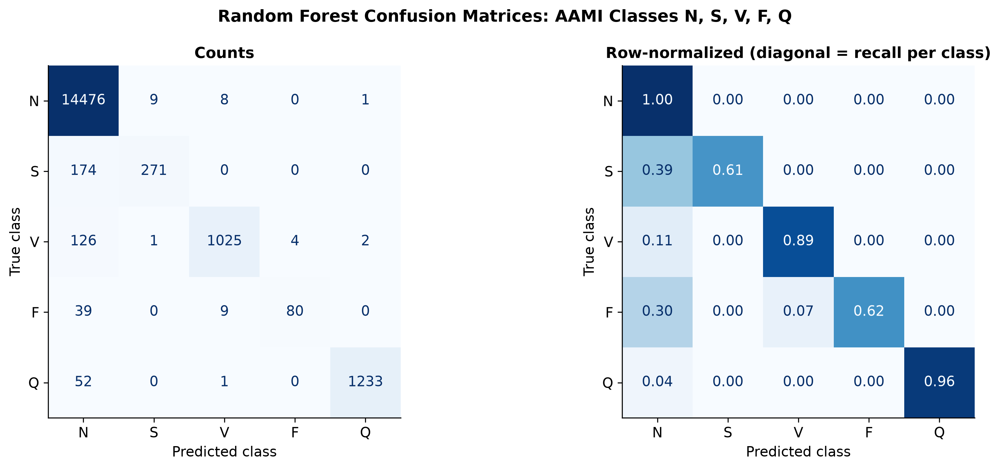
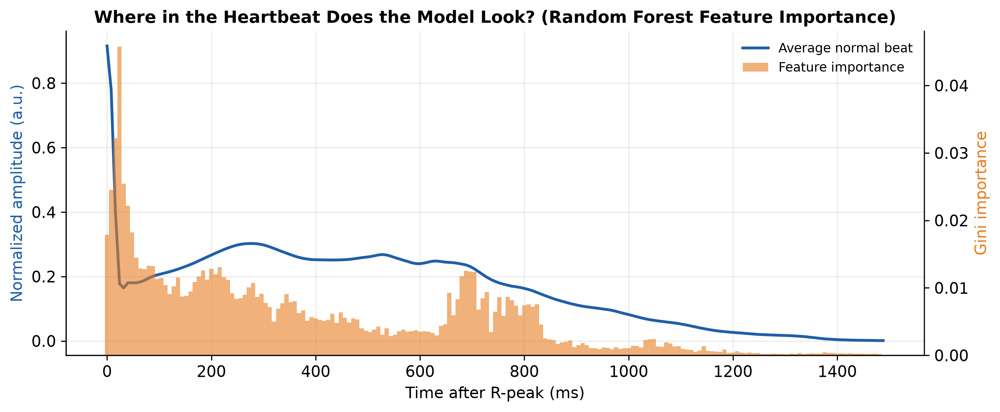
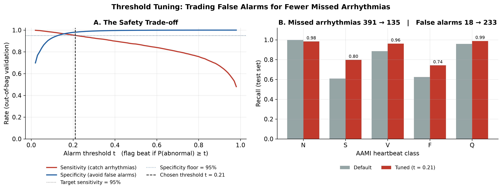

# ECG Arrhythmia Detector

A machine-learning pipeline and interactive dashboard that reads a single heartbeat from a real hospital ECG recording and flags it as normal or one of four arrhythmia types. Built in Python with scikit-learn and Streamlit, trained on the MIT-BIH Arrhythmia Database.

**Headline results**

- **65% fewer missed arrhythmias.** Tuning the alarm threshold on out-of-bag data cut missed arrhythmias from 391 to 135 (sensitivity 87.0% → 95.5%) while specificity stayed at 98.4%.
- **57% of noise damage recovered.** Under simulated hospital noise, diagnostic accuracy fell from 90.6% to 72.4%; a three-stage filter pipeline restored it to 82.8%.
- **Unreliable signals rejected.** A signal-quality check caught every simulated loose electrode and flagged none of the clean beats.

## The dashboard

| Beat explorer | Safety trade-off | Noise lab |
|---|---|---|
|  |  |  |
| Pick any test heartbeat, drawn on real ECG paper, and compare the model's diagnosis to the cardiologist's label. | Drag the alarm threshold and watch missed arrhythmias and false alarms trade off live. | Add realistic hardware noise, filter it out, and test whether the diagnosis survives. |

## How it works



The signal path used in the Noise lab. The model itself was trained on the dataset's pre-cleaned beats.

## Data

The [Kaggle version](https://www.kaggle.com/datasets/shayanfazeli/heartbeat) of the MIT-BIH Arrhythmia Database (Kachuee et al., 2018): 87,554 single heartbeats from 47 patients, each 187 samples at 125 Hz and labeled by cardiologists into five AAMI classes.

| Class | Meaning | Beats |
|---|---|---|
| N | Normal | 72,471 (82.8%) |
| S | Supraventricular ectopic: starts in the upper chambers | 2,223 (2.5%) |
| V | Ventricular ectopic: starts in the lower chambers | 5,788 (6.6%) |
| F | Fusion of a normal and a ventricular beat | 641 (0.7%) |
| Q | Paced or unclassifiable | 6,431 (7.3%) |



The severe imbalance is the central challenge: a model that answers "Normal" every time scores 82.8% accuracy while catching zero arrhythmias. That is why this project judges models by **sensitivity** (arrhythmias caught) rather than accuracy.

## Results

### What arrhythmias look like



The bold line in each panel is the class medoid, the real beat most similar to all others, judged on the first 600 ms. The normal beat shows the full R → T → P → R cycle. The ventricular beat shows a much deeper drop after the R-peak and no clean T wave, signs of abnormal activation and recovery. The gray region is where the next heartbeat arrives, which varies with each patient's heart rate.

### Baseline model

A Random Forest (200 trees, class-balanced weights) on a stratified 80/20 split: 97.6% accuracy, but only 87.0% sensitivity.



Almost every error falls in the first column: when the model is wrong, it is nearly always wrong by saying "Normal." That one-directional pattern is exactly what threshold tuning fixes.

### What the model looks at



Importance clusters in three places: 0–80 ms (QRS width, the key sign of a ventricular beat), 150–350 ms (the T wave), and 650–850 ms, where the next beat arrives. The model learned to use heart-rhythm timing, not just beat shape.

### Safety tuning

Instead of flagging a beat only when "abnormal" is the top guess, the tuned model flags it whenever P(abnormal) ≥ t. The threshold t = 0.21 was chosen on **out-of-bag** predictions (each training beat scored only by trees that never saw it), so the test set stayed untouched. A guardrail kept specificity above 95% to avoid alarm fatigue.



| Metric | Default | Tuned (t = 0.21) |
|---|---|---|
| Sensitivity | 87.0% | **95.5%** |
| Specificity | 99.9% | 98.4% |
| Missed arrhythmias | 391 | **135** |
| False alarms | 18 | 233 |
| Balanced accuracy | 81.5% | **89.5%** |

Recall per class, default → tuned: S 60.9% → 79.8%, V 88.5% → 96.2%, F 62.5% → 74.2%, Q 95.9% → 98.8%, N 99.9% → 98.4%. The trade: 215 extra false alarms (1.6% of normal beats) to catch 256 more arrhythmias.

### Robustness to hardware noise

Noise settings: breathing drift 0.25, 60 Hz power-line hum 0.05, muscle noise 0.03, at t = 0.21, on a class-balanced sample of 928 test beats (200 per class; Fusion has 128).

| Condition | Correct type | Arrhythmias caught | Normal beats cleared |
|---|---|---|---|
| Original beats | 90.6% | 92.3% | 97.5% |
| With noise, no filters | 72.4% | 79.5% | 92.0% |
| With noise, then filters | **82.8%** | **84.2%** | **98.0%** |
| Clean beats through filters | 87.3% | 89.3% | 98.0% |

Because the sample is balanced, rare hard classes weigh more here than in real life, so sensitivity is lower than on the full test set.

## Engineering decisions

**Tuned the threshold on out-of-bag data, not the test set.** Choosing a threshold by looking at test results would quietly fit it to those exact beats and inflate the reported score. Out-of-bag predictions give a free validation set without retraining.

**Replaced the textbook high-pass filter.** The standard 0.5 Hz high-pass filter for breathing drift made signals *worse*, distorting even clean beats: it needs about 2 s of signal, and these segments are about 1 s. Of six alternatives tested, a two-stage median filter (200 ms, then 600 ms) cut drift error by more than half with minimal distortion. It is also the published baseline-removal method for MIT-BIH (de Chazal et al., 2004).

**Checked signal quality before filtering.** A loose electrode saturates the amplifier into a flat line that no filter can repair, and filtering would smear the evidence. The quality check runs on the raw signal and rejects unreliable segments rather than diagnosing them.

**Chose representative beats by medoid, not average.** Ventricular beats vary so much between patients that their average is a featureless blur. The medoid is always a real, typical beat.

## Limitations

- **Same patients in training and testing.** The Kaggle files have no patient IDs, so beats from the same 47 people appear on both sides of the split. Published inter-patient studies (de Chazal et al., 2004) show performance drops substantially on unseen patients.
- **One beat at a time.** Each segment starts at its R-peak, so the model never sees the gap before a beat. Supraventricular beats are diagnosed largely from that gap, which is why S remains the hardest class (1 in 5 missed).
- **Train–test mismatch for filters.** The model was trained on unfiltered beats, so filtering a perfect beat still costs about 3 points of sensitivity.
- **Simulated noise.** Real hardware noise is messier than the synthetic noise used here.

## Future work

- Retrain on filtered beats to remove the filter mismatch.
- Add RR-interval (beat-to-beat timing) features from the full PhysioNet recordings to improve supraventricular detection.
- Evaluate on an inter-patient split using the original PhysioNet records, which include patient IDs.

## Run it yourself

Requires Python 3.10+.

```bash
git clone https://github.com/anishm113/ecg-arrhythmia-dashboard.git
cd ecg-arrhythmia-dashboard
python3 -m venv venv
source venv/bin/activate          # Windows: venv\Scripts\activate
pip install -r requirements.txt
```

Download `mitbih_train.csv` from [Kaggle](https://www.kaggle.com/datasets/shayanfazeli/heartbeat) into `data/`, then:

```bash
python step1_visualize.py          # data checks + figures 1-2
python step2_train_model.py        # baseline model + figures 3-4
python step2b_tune_threshold.py    # safety tuning + figure 5
streamlit run app.py               # dashboard at http://localhost:8501
```

## Project structure

```
ecg-arrhythmia-dashboard/
├── app.py                   Streamlit dashboard
├── signal_processing.py     noise simulation, filters, quality check
├── ecg_utils.py             shared loading, cleaning, and constants
├── step1_visualize.py       data cleaning and morphology figures
├── step2_train_model.py     Random Forest training and evaluation
├── step2b_tune_threshold.py out-of-bag threshold tuning
├── figures/                 generated figures
├── screenshots/             dashboard screenshots
├── models/                  metrics, threshold, dashboard cache
└── data/                    mitbih_train.csv (download separately)
```

## References

1. Moody GB, Mark RG. The impact of the MIT-BIH Arrhythmia Database. *IEEE Engineering in Medicine and Biology*, 20(3):45–50, 2001.
2. Goldberger AL, et al. PhysioBank, PhysioToolkit, and PhysioNet. *Circulation*, 101(23):e215–e220, 2000.
3. Kachuee M, Fazeli S, Sarrafzadeh M. ECG heartbeat classification: a deep transferable representation. *IEEE International Conference on Healthcare Informatics*, 2018.
4. de Chazal P, O'Dwyer M, Reilly RB. Automatic classification of heartbeats using ECG morphology and heartbeat interval features. *IEEE Transactions on Biomedical Engineering*, 51(7):1196–1206, 2004.
5. ANSI/AAMI EC57: Testing and reporting performance results of cardiac rhythm and ST segment measurement algorithms.

---

Built by Anish Murugan as an independent research project. This is not a medical device and is not for clinical use.
